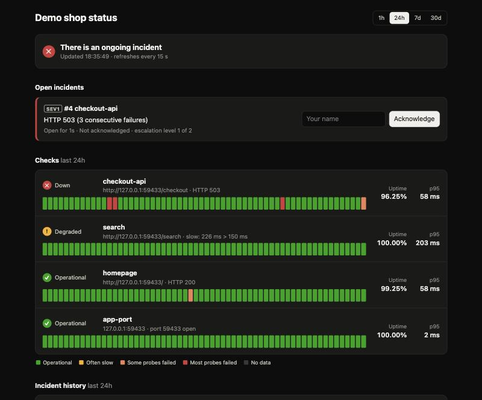

# straža

**Uptime monitoring, incident tracking and on-call escalation in a single SQLite file.**
Python standard library only: no dependencies, no agents, no external database.

*Straža* is Croatian for a guard on watch.



It probes your services (HTTP, TCP, DNS, TLS certificates), decides when a
failure is a real incident and not a network hiccup, tells the right people,
escalates if nobody responds, and keeps the history needed to answer
"what was our uptime last month and how fast did we react?".

## Try it in 30 seconds

```bash
pip install .
```

```bash
straza demo
```

The demo starts a small fake shop on localhost whose checkout endpoint goes
down for 25 seconds every 75 seconds, points a real monitor at it and opens
the status page on <http://127.0.0.1:8080/>. This is what the terminal shows
(real output):

```
18:34:53 straza.monitor: monitoring 4 checks
18:35:48 [SEV1] OPENED #4 checkout-api - HTTP 503 (3 consecutive failures)
18:36:01   webhook received: [SEV1] ESCALATED #4 checkout-api - HTTP 503 (3 consecutive failures) (unacknowledged for 13s)
18:36:11 [SEV1] RESOLVED #4 checkout-api - HTTP 503 (3 consecutive failures) (down for 23s)
18:36:11   webhook received: [SEV1] RESOLVED #4 checkout-api - HTTP 503 (3 consecutive failures) (down for 23s)
```

Three failed probes in a row open the incident. Nobody acknowledges it, so
after the configured delay it escalates to the on-call webhook. Two good
probes in a row resolve it, and everyone who was alerted is told it is over.
Acknowledge it on the page (or with `straza ack`) before the delay passes and
the escalation never fires.

## Using it

```bash
straza init
```

writes an example `straza.json`. Edit the checks, then:

```bash
straza run
```

| Command | What it does |
|---|---|
| `straza run` | run the monitor and the status page |
| `straza check` | probe everything once and exit 1 if anything is down (for cron and CI) |
| `straza status` | current state, uptime and p95 latency per check |
| `straza incidents [--all]` | open (or all) incidents |
| `straza show ID` | one incident with its full event log |
| `straza ack ID` | acknowledge: "someone is on it", stops escalation |
| `straza report --days 30` | availability report in Markdown |
| `straza demo` | the playground described above |

```
$ straza status
CHECK         STATUS    UPTIME 24h  P95     CHECKED  DETAIL
checkout-api  UP        95.68%      58 ms   2s ago   HTTP 200
search        DEGRADED  100.00%     203 ms  2s ago   slow: 188 ms > 150 ms
homepage      UP        99.26%      58 ms   2s ago   HTTP 200
app-port      UP        100.00%     2 ms    2s ago   port 59433 open

$ straza show 4
Incident #4  SEV1  checkout-api
Cause: HTTP 503 (3 consecutive failures)

  2026-11-16 18:35:48  opened        HTTP 503 (3 consecutive failures)
  2026-11-16 18:35:48  escalated     level 0 -> console
  2026-11-16 18:36:01  escalated     level 1 -> on-call
  2026-11-16 18:36:11  resolved      recovered after 23s
```

`straza report` produces the document you send when the month ends:

| Check | Severity | Uptime | Probes | Incidents | Downtime | MTTA | MTTR | p95 latency |
|---|---|---:|---:|---:|---:|---:|---:|---:|
| checkout-api | sev1 | 95.682% | 1482 | 3 | 46m 23s | 3m 43s | 15m 28s | 58 ms |
| search | sev2 | 100.000% | 1482 | 0 | - | - | - | 203 ms |
| homepage | sev2 | 99.258% | 1482 | 1 | 8m 00s | 1m 28s | 8m 00s | 58 ms |

### Configuration

```json
{
  "database": "straza.db",
  "defaults": { "interval": 30, "timeout": 5, "failures_to_open": 3, "successes_to_resolve": 2 },
  "checks": [
    { "name": "website", "type": "http", "url": "https://example.com/",
      "expect_status": [200], "expect_body": "ok", "max_latency_ms": 1500, "severity": "sev1" },
    { "name": "website-cert", "type": "tls", "host": "example.com", "warn_days": 21, "interval": 3600 },
    { "name": "dns", "type": "dns", "host": "example.com", "expect_ip": "93.184.215.14" },
    { "name": "database-port", "type": "tcp", "host": "10.0.0.5", "port": 5432, "severity": "sev1" }
  ],
  "notifiers": {
    "console": { "type": "console" },
    "alert-log": { "type": "file", "path": "alerts.jsonl" },
    "on-call": { "type": "webhook", "url": "https://hooks.example.com/..." }
  },
  "escalation": [
    { "after_minutes": 0,  "notify": ["console", "alert-log"] },
    { "after_minutes": 15, "notify": ["on-call"] }
  ]
}
```

| Check type | Passes when | Extra options |
|---|---|---|
| `http` | status is in `expect_status` (and the body contains `expect_body`) | `max_latency_ms` |
| `tcp` | the port accepts a connection | |
| `dns` | the name resolves (to `expect_ip`, if given) | |
| `tls` | the certificate is valid; *degraded* when it expires within `warn_days` | |

The webhook notifier posts JSON with a top-level `text` field, which is the
format Slack-compatible incoming webhooks display.

The config is validated before anything starts, and every problem is reported
at once with the path to the offending key. A typo such as `"intervall"` is an
error, not a silently ignored setting:

```
straza: invalid configuration:
  - checks[website].intervall: unknown key
  - escalation[1].notify: unknown notifier(s): oncall
```

## How it works

```
            ┌────────────┐   results    ┌──────────────────┐   alerts   ┌───────────┐
 config ──► │  Monitor   │ ───────────► │ IncidentManager  │ ─────────► │ notifiers │
            │ (run loop) │              │ (the four rules) │            └───────────┘
            └─────┬──────┘              └────────┬─────────┘
          probes in a                            │ reads / writes
          thread pool                            ▼
            ┌─────┴──────┐              ┌──────────────────┐ ◄── status page, JSON API
            │   checks   │              │  Store (SQLite)  │ ◄── straza status / report
            │ http tcp…  │              └──────────────────┘ ◄── straza ack (other process)
            └────────────┘
```

| File | Role |
|---|---|
| [`config.py`](src/straza/config.py) | load and validate the JSON config |
| [`checks.py`](src/straza/checks.py) | the probes; each returns `up`, `degraded` or `down` and never raises |
| [`incidents.py`](src/straza/incidents.py) | when to open, resolve and escalate |
| [`store.py`](src/straza/store.py) | schema and every SQL query |
| [`monitor.py`](src/straza/monitor.py) | the scheduling loop |
| [`notify.py`](src/straza/notify.py) | console, file and webhook notifiers |
| [`status.py`](src/straza/status.py), [`web.py`](src/straza/web.py) | one snapshot, rendered as HTML and JSON |
| [`report.py`](src/straza/report.py) | the Markdown availability report |

### The incident rules

1. **One failed probe is not an incident.** An incident opens after
   `failures_to_open` failures in a row.
2. **One good probe does not end it.** It resolves after
   `successes_to_resolve` successes in a row, so a service flapping up and
   down produces one incident, not twenty.
3. **Unacknowledged incidents climb the escalation ladder.** Each step fires
   once, when the incident has been open that long. The opening alert is
   simply step 0.
4. **Acknowledging stops the climb, not the incident.** When it resolves,
   everyone who was alerted is told.

### The numbers are SQL

Every figure on the status page, in the CLI and in the report comes from one
query in `store.py`, so they cannot disagree. SQLite has no percentile
function; p95 is computed with a window function and the nearest-rank
definition (the value at position ⌈0.95·n⌉, the ceiling done in integer
arithmetic):

```sql
WITH ranked AS (
    SELECT check_name, latency_ms,
           ROW_NUMBER() OVER (PARTITION BY check_name ORDER BY latency_ms) AS rn,
           COUNT(*)     OVER (PARTITION BY check_name)                     AS n
    FROM results WHERE ts >= ? AND ts < ? AND latency_ms IS NOT NULL
)
SELECT check_name, latency_ms AS p95 FROM ranked WHERE rn = (n * 95 + 99) / 100;
```

Downtime in the report clips each incident to the reporting period, so an
incident that starts in one month and ends in the next is split correctly:

```sql
SUM(MIN(COALESCE(resolved_at, :until), :until) - MAX(opened_at, :since))
```

## Design decisions

- **SQLite, in WAL mode.** One file to back up, real SQL for the reports, and
  WAL lets a second process (`straza ack` in another terminal) write while
  the monitor is running.
- **No dependencies.** A monitoring tool is the thing that must still work
  when everything else is broken; `pip install` with nothing to resolve is
  part of that.
- **Three states, not two.** A slow answer is `degraded`: visible on the
  page, counted in the report, but it does not page anyone. Latency of a
  failed probe is not recorded, because "how long it took to fail" would
  poison the percentiles.
- **Probes run in parallel, results are processed on one thread.** The
  network waiting happens in a thread pool; the incident rules run on the
  loop thread only, so they need no locking and two results for one check can
  never race.
- **Acknowledging is a single `UPDATE ... WHERE acked_at IS NULL`.** If two
  people acknowledge at the same moment, exactly one wins.
- **A failing notifier never stops the monitor.** The webhook may well be
  unreachable during the outage being reported; that is logged and the loop
  goes on.
- **The opening alert is escalation step 0.** One code path for "tell
  people", and steps missed while the monitor was restarting all fire when it
  comes back.

## Deploying

- [`deploy/straza.service`](deploy/straza.service): a hardened systemd unit
  (`journalctl -u straza -f` to follow it).
- [`deploy/Dockerfile`](deploy/Dockerfile): a small image running as a
  non-root user. I have not built this image myself yet; treat it as a
  starting point.

`straza` shuts down cleanly on SIGTERM, which is what both `systemctl stop`
and `docker stop` send. `GET /healthz` lets something else watch the watcher.

## Limits, honestly

- One node, one vantage point: it cannot tell "the service is down" from "my
  network is down". Real setups probe from several locations.
- The status page has no authentication. It binds to 127.0.0.1 by default,
  and acknowledging from the page is off unless `web.allow_ack` is set.
- DNS lookups use the system resolver and are not bounded by `timeout`.
- Results are kept for `retention_days` (default 90); incidents are kept
  forever.

## Tests

```bash
pip install -e ".[dev]"
```

```bash
pytest
```

51 tests. The incident rules are tested with a hand-set clock (no sleeping),
the probes against a local HTTP server the tests control, and the SQL against
known data, including the p95 definition and incident clipping.

## License

MIT
